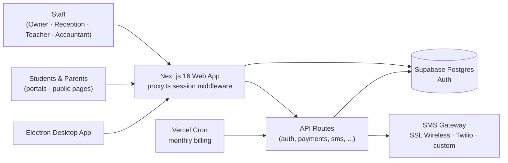

<div align="center">


# Coaching Management System

**White-label platform for coaching centers**

All-in-one platform to run a coaching center — students, batches, fees, exams, attendance, and communication — with multi-branch support, a student &amp; parent portal, bulk SMS, and a Windows desktop edition. Each institute runs its own deployment with its own database and branding.

> **Proprietary &amp; Closed-Source Software.** © 2026 MedhaShiree. All rights reserved.

[](#-license)
[](https://nextjs.org)
[](https://react.dev)
[](https://www.typescriptlang.org)
[](https://tailwindcss.com)
[](https://supabase.com)
[](https://www.electronjs.org)
[](https://vercel.com)
[](#)
[](#-project-status)

</div>

---

## Table of Contents

- [Features](#-features)
- [Tech Stack](#-tech-stack)
- [Architecture](#-architecture)
- [Project Structure](#-project-structure)
- [Getting Started](#-getting-started)
- [Environment Variables](#-environment-variables)
- [Database & Migrations](#-database--migrations)
- [Branding & White-labeling](#-branding--white-labeling)
- [Scripts](#-scripts)
- [User Roles](#-user-roles)
- [SMS Providers](#-sms-providers)
- [Desktop Edition](#-desktop-edition)
- [Deployment](#-deployment)
- [Project Status](#-project-status)
- [Security](#-security)
- [Support & Contact](#-support--contact)
- [Acknowledgements](#-acknowledgements)
- [License](#-license)

---

## Features

<table>
<tr><td width="50%" valign="top">

**Students & Enrollment**
- Student registration &amp; profiles
- Single and bulk **CSV enrollment**
- Per-batch **roll-number management** (auto-assign, serial numbering, manual conflict resolution)
- Batch assignment &amp; referrals
- Student / enrollment **QR codes**

**Batches, Branches & Staff**
- Create batches &amp; assign teachers
- Track batch occupancy
- Multiple branches
- Staff accounts with granular permissions

**Attendance**
- Manual entry
- **QR scan** attendance
- **Biometric entry** with fee-alert alerts

</td><td width="50%" valign="top">

**Fees & Billing**
- Payments &amp; auto-generated receipts
- Fee dues tracking
- **Monthly dues auto-generation** (Vercel Cron)
- Payment approvals flow
- Expenses &amp; revenue analytics

**Exams & Results**
- Create exams &amp; enter marks
- Leaderboards &amp; weekly exams
- **Public result verification**

**Communication**
- **Bulk SMS** (mock / SSL Wireless / Twilio / custom gateway)
- Notices &amp; in-app notifications

**Public Pages &amp; Portals**
- Online enrollment
- Student portal &amp; parent portal
- Course marketplace
- Public results

**Site Management**
- Slider, site content &amp; branch configuration
- **Institute branding** — name, logo, favicon, tagline and theme colour, stored in the database

</td></tr>
</table>

---

## Tech Stack

| Layer | Technology |
| :--- | :--- |
| **Framework** | Next.js 16 (App Router) · React 19 · TypeScript |
| **UI & Charts** | Tailwind CSS v4 · Radix UI · lucide-react · Recharts · sonner |
| **Forms** | react-hook-form + Zod |
| **Backend / DB** | Supabase (PostgreSQL, Auth) |
| **Documents & Data** | jsPDF + jsPDF-autotable · xlsx |
| **QR / Scanning** | html5-qrcode |
| **Desktop** | Electron 44 (electron-builder → Windows NSIS + portable) |
| **Hosting** | Vercel (serverless + scheduled cron) |

---

## Architecture



---

## Project Structure

```text
.
├── app/                      # Next.js App Router
│   ├── dashboard/            # Role consoles: owner, reception, teacher, accountant
│   ├── student/              # Student portal
│   ├── api/                  # Server routes (auth, attendance, payments, sms, ...)
│   └── ...                   # Public pages: login, signup, enroll, marketplace, results
├── components/               # Shared UI components (incl. BrandingContext)
├── lib/                      # Utilities, Supabase clients, branding, SMS provider
├── electron/                 # Desktop shell (main.js, preload.js, offline fallback)
├── supabase/                 # COMPLETE_SETUP.sql + incremental migrations
├── proxy.ts                  # Auth / session middleware (Next.js 16)
├── vercel.json               # Cron schedule
└── package.json
```

---

## Getting Started

### Prerequisites

- **Node.js 20+** and npm
- A **Supabase** project ([supabase.com](https://supabase.com))

### Quick Start

```bash
# 1. Install dependencies
npm install

# 2. Configure the database (see "Database & Migrations")
# 3. Add your keys to .env.local (see "Environment Variables")

# 4. Run the dev server
npm run dev
```

Open [http://localhost:3000](http://localhost:3000).

---

## Environment Variables

Create **`.env.local`** in the project root:

| Variable | Required | Description |
| :--- | :---: | :--- |
| `NEXT_PUBLIC_SUPABASE_URL` | ✅ | Your Supabase project URL |
| `NEXT_PUBLIC_SUPABASE_ANON_KEY` | ✅ | Supabase anon (public) key |
| `SUPABASE_SERVICE_ROLE_KEY` | ✅ | Supabase service-role key (server-side only) |
| `NEXT_PUBLIC_APP_NAME` | ✅ (prod) | Institute name used for metadata, SMS sender, export filenames and other fallbacks before the DB branding loads |
| `NEXT_PUBLIC_APP_URL` | ✅ (prod) | Public origin of the deployment; used to build student QR verification links. Must match the Vercel URL in production |
| `SMS_PROVIDER` | — | `mock` *(default)*, `ssl_wireless`, or `twilio` |
| `SSL_WIRELESS_API_KEY` / `SSL_WIRELESS_SID` | — | Required when `SMS_PROVIDER=ssl_wireless` |
| `TWILIO_ACCOUNT_SID` / `TWILIO_AUTH_TOKEN` / `TWILIO_FROM_NUMBER` | — | Required when `SMS_PROVIDER=twilio` |
| `APP_SERVER_URL` | — | Server URL the desktop app loads (defaults to the hosted app) |
| `CRON_SECRET` | ✅ (prod) | Bearer secret Vercel Cron uses to call `/api/cron/billing`; the route returns `503` when unset |
| `VAULT_SYNC_TOKEN` | — | Shared secret for `POST /api/vault/sync`; required for the desktop offline queue (use the same value on Vercel and each PC) |

```env
NEXT_PUBLIC_SUPABASE_URL=https://your-project.supabase.co
NEXT_PUBLIC_SUPABASE_ANON_KEY=your-anon-key
SUPABASE_SERVICE_ROLE_KEY=your-service-role-key
NEXT_PUBLIC_APP_NAME=Your Coaching Center
NEXT_PUBLIC_APP_URL=https://your-app.vercel.app
SMS_PROVIDER=mock
CRON_SECRET=your-cron-secret
VAULT_SYNC_TOKEN=your-vault-sync-token
```

> **Deployment note:** the cron and desktop-sync secrets are currently **not
> set**. See [`docs/PENDING_SETUP.md`](docs/PENDING_SETUP.md) for exact steps,
> current behaviour and the deferred Cloudflare assessment.

---

## Database & Migrations

Each institute runs against its **own** Supabase project — the app never shares a database between deployments. Point `.env.local` (or the Vercel env vars) at that institute's project.

**Option A — Fresh or catch-up (recommended).** In the Supabase **SQL Editor**, run the entire
[`supabase/COMPLETE_SETUP.sql`](supabase/COMPLETE_SETUP.sql). It is idempotent and safe to re-run in one
go: it creates/retrofits every table, column, index, function, trigger and policy, backfills QR codes and
roll numbers, links an existing Auth user as the **Owner**, and reloads the PostgREST schema cache. It
contains no `DROP TABLE`/`DROP COLUMN`/`DELETE`, and `site_settings` inserts use `ON CONFLICT DO NOTHING`, so
existing branding and data are preserved.

**Option B — Incremental.** If your database is already provisioned, apply only the newer files in
[`supabase/migrations/`](supabase/migrations) **in order**, running each one in the SQL Editor. Migrations are
currently applied through `039_align_exams_schema.sql`.

> The `COMPLETE_SETUP.sql` is the single source of truth and always includes the latest migration, so it is
> usually the simplest path. Take a Supabase backup first if the database holds real data.

### Create the Owner account

1. In Supabase, go to **Authentication → Users** and create a user (email/password).
2. Re-run `COMPLETE_SETUP.sql` — it automatically links the first Auth user as the **Owner**.
   (Or insert the `staff` row manually with `role = 'owner'`.)

> Migrations are applied **manually** in the Supabase SQL Editor.

### Auth URLs

In **Authentication → URL Configuration**, set the **Site URL** to the deployment origin and add it to
**Redirect URLs**, otherwise login and password-reset links will point at localhost.

---

## Branding & White-labeling

The application has no hardcoded institute identity. Name, Bangla name, short name, tagline, logo, favicon and
theme colour are read from the `institute_branding` row in the `site_settings` table:

- **Server-side** — [`lib/branding-server.ts`](lib/branding-server.ts) supplies page metadata (title,
  description, favicon) rendered by `app/layout.tsx`.
- **Client-side** — `BrandingContext` loads the same setting, applies the theme palette and keeps the browser
  title/favicon in sync.
- **Editing** — log in as the Owner and open **Dashboard → Homepage Editor → Institute Name & Identity** to
  change branding. Saving writes back to `site_settings`.
- **Fallbacks** — `NEXT_PUBLIC_APP_NAME` and `NEXT_PUBLIC_APP_URL` are used only before the database value
  loads (metadata, SMS sender prefix, export filenames, QR verification links).

Synthetic login emails (`<id>@<domain>.local`) and a few `localStorage` keys are intentionally not branded, so
existing accounts and cached state keep working across re-skins.

---

## Scripts

| Script | Description |
| :--- | :--- |
| `npm run dev` | Start the Next.js dev server |
| `npm run build` | Production build |
| `npm run start` | Start the production server |
| `npm run lint` | Run ESLint |
| `npm run electron:dev` | Run the desktop app against the dev server |
| `npm run electron:pack` | Package the desktop app (unpacked) |
| `npm run electron:build` | Build the Windows installer + portable `.exe` |

---

## User Roles

| Role | Access |
| :--- | :--- |
| **Owner** | Full access to all modules and branches |
| **Super Manager · Manager · Branch Director** | Management access; branch-scoped where applicable |
| **Receptionist** | Students, enrollment, payments, attendance, biometric entry |
| **Teacher · Course Teacher** | Own batches, attendance, exams, results, courses |
| **Accountant** | Payments, fee dues, expenses, reports |

---

## SMS Providers

| Provider | `SMS_PROVIDER` | Notes |
| :--- | :--- | :--- |
| Mock | `mock` *(default)* | Logs messages, no delivery — for development |
| SSL Wireless | `ssl_wireless` | Requires `SSL_WIRELESS_API_KEY` + `SSL_WIRELESS_SID` |
| Twilio | `twilio` | Requires `TWILIO_ACCOUNT_SID`, `TWILIO_AUTH_TOKEN`, `TWILIO_FROM_NUMBER` |
| Custom gateway | — | Configured per branch (API key + URL template) |

---

## Desktop Edition

An Electron shell wraps the hosted web app for Windows:

```bash
npm run electron:dev     # develop against the running server
npm run electron:pack    # unpacked build for testing
npm run electron:build   # installer + portable .exe in dist/
```

Point the desktop app at any server with `APP_SERVER_URL`. An offline fallback page is included in `electron/offline/`.

---

## Deployment

1. Create a **separate Supabase project per institute** and run `COMPLETE_SETUP.sql` against it.
2. Import this repository at [vercel.com](https://vercel.com) and create one Vercel project per institute.
3. Add the environment variables above in **Project Settings → Environment Variables** — including
   `NEXT_PUBLIC_APP_NAME` and `NEXT_PUBLIC_APP_URL` set to that institute's name and domain.
4. Set the Supabase **Auth Site URL / Redirect URLs** to the deployment domain.
5. Deploy. [`vercel.json`](vercel.json) schedules `/api/cron/billing` to run monthly for automatic due
   generation (requires `CRON_SECRET`; see [`docs/PENDING_SETUP.md`](docs/PENDING_SETUP.md)).

---

## Project Status

This project is under active development. Known issues and the ongoing fix list are tracked in
[`BUG_REPORT.md`](BUG_REPORT.md).

Recent work: database-driven (white-label) branding, exam-schema alignment so weekly/routine exams save, a
homepage batch-query fix, and small-viewport/zoom overflow hardening.

This is a **private, proprietary repository**. Redistribution of the source code is not permitted — see [License](#-license).

---

## Security

- **Authentication** is handled by Supabase Auth, with sessions enforced through the app's auth middleware (`proxy.ts`).
- **Authorization** is role-based and enforced on every server route via `lib/api-auth.ts`.
- **Privileged operations** run server-side using the Supabase **service-role** key, which is never exposed to the browser.
- **Secrets** are provided exclusively through environment variables and must never be committed to the repository.
- Access-control hardening is ongoing; see [`BUG_REPORT.md`](BUG_REPORT.md) for the current status.

---

## Support & Contact

For support, deployment assistance, or licensing inquiries, contact the maintainers. Each institute's live
application is hosted at its own domain (configured through `NEXT_PUBLIC_APP_URL`).

---

## Acknowledgements

This product is built on excellent open-source software:

- [Next.js](https://nextjs.org) · [React](https://react.dev) · [Tailwind CSS](https://tailwindcss.com)
- [Supabase](https://supabase.com) — database &amp; authentication
- [Radix UI](https://www.radix-ui.com) · [Recharts](https://recharts.org) · [lucide](https://lucide.dev) · [Sonner](https://sonner.emilkowal.ski)
- [Electron](https://www.electronjs.org) & [electron-builder](https://www.electron.build)

---

## License

**Copyright © 2026 MedhaShiree. All Rights Reserved.**

This is **proprietary, closed-source software**. It is made available for use only under the terms granted by
MedhaShiree. No part of this software may be copied, modified, distributed, sublicensed, or published — in whole or
in part, in source or binary form — without prior written permission from the copyright holder. See [`LICENSE`](LICENSE)
for the full terms.

<div align="center">
<sub>Built with Next.js, Supabase &amp; Electron — for coaching centers that want to run smarter.</sub>
</div>
